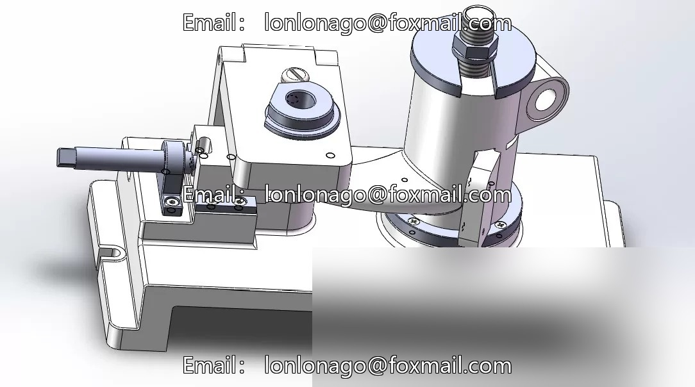
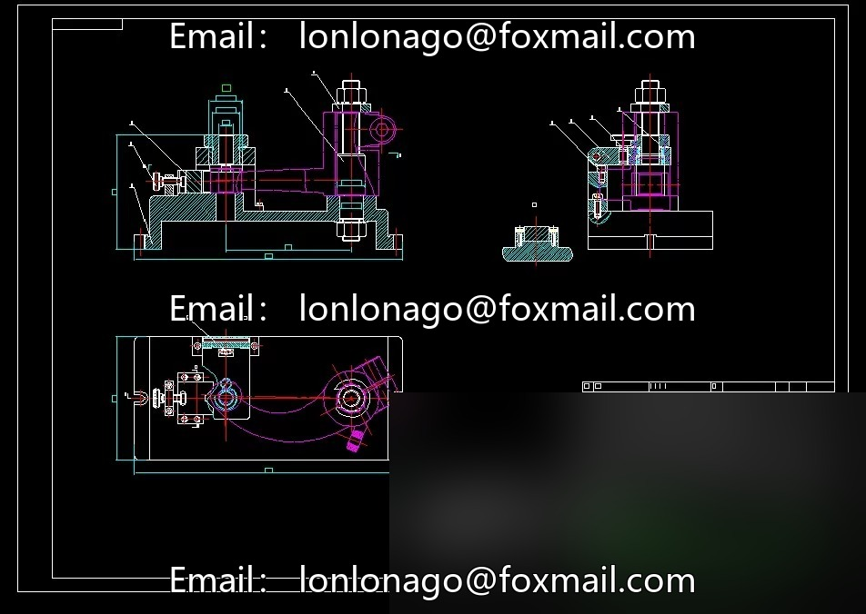
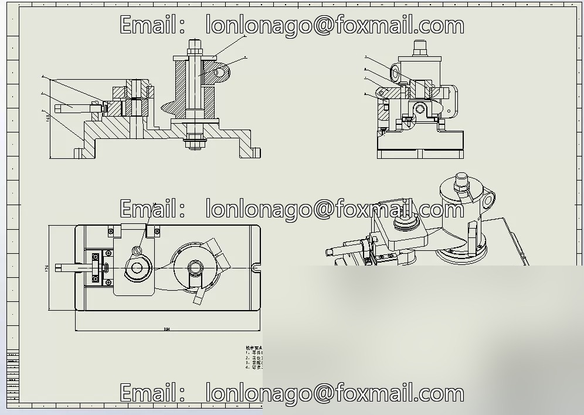

# Customized part process and fixture design

## Body

Customized part process and fixture design; customized part process regulations and fixture design.
Customized parts include processes for dial pins, gears, shafts, links, handles, pushing frames, bearing seats, levers, shaft sleeves, flange disks, etc., as well as process regulations and fixture design.
The customized contents include: 1, part analysis: the function of the part and the process analysis of the part. 2, process regulation design: blank selection, basis selection, and establishment of the process route. 3, fixture design: clamping force calculation, positioning error analysis, etc.
Draw two-dimensional and three-dimensional diagrams such as part drawings, blank drawings, fixture drawings, and fixture assembly drawings in UG, solidworks.
There is also the sale of final product process and fixture design.

The content covers customized part processing and fixture design, including part analysis, process design, and fixture design, along with 2D and 3D drawings produced in UG and solidworks.

<!-- AI_ENRICHED -->

## Images

## Payment

Here is a pay link on Stripe ( https://buy.stripe.com/3cs8yP7sY87d0vu9AB ). Please contact me lonlonago@foxmail.com after funding $89, and I will send you a complete data files , thank you!

